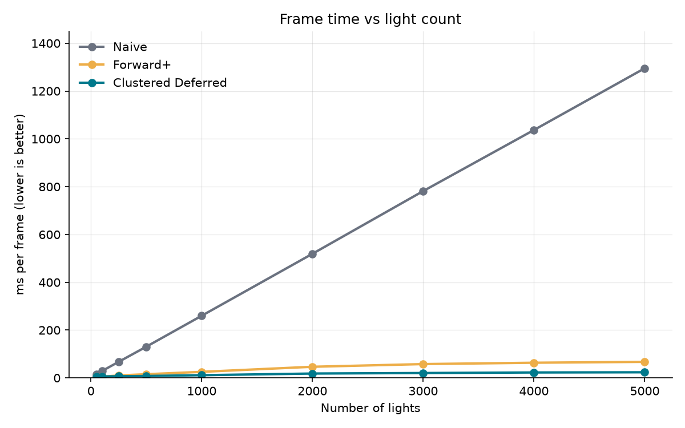
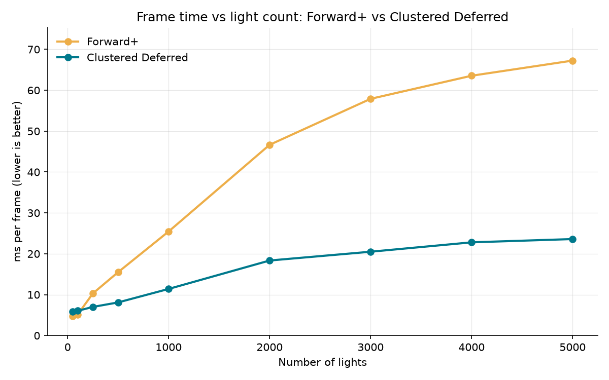
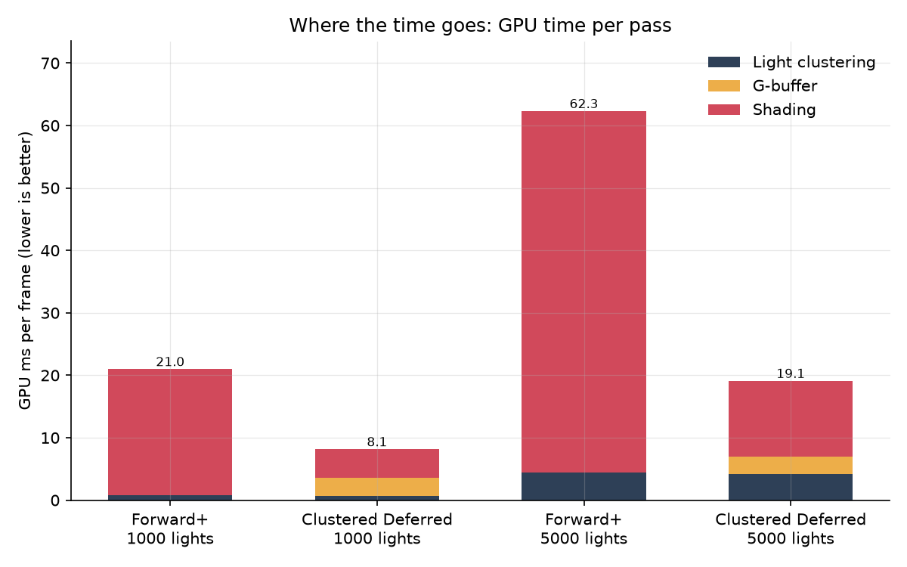
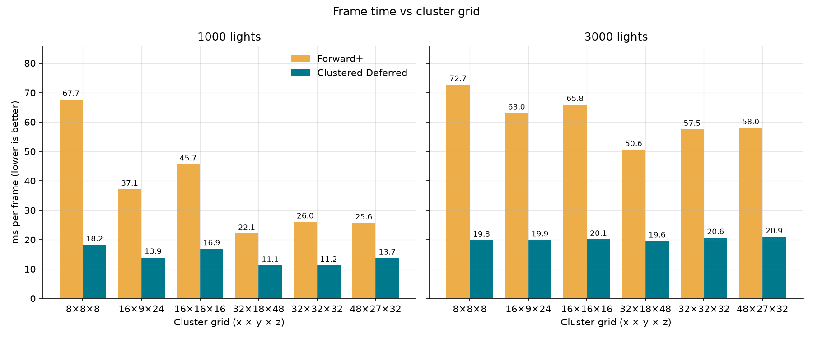
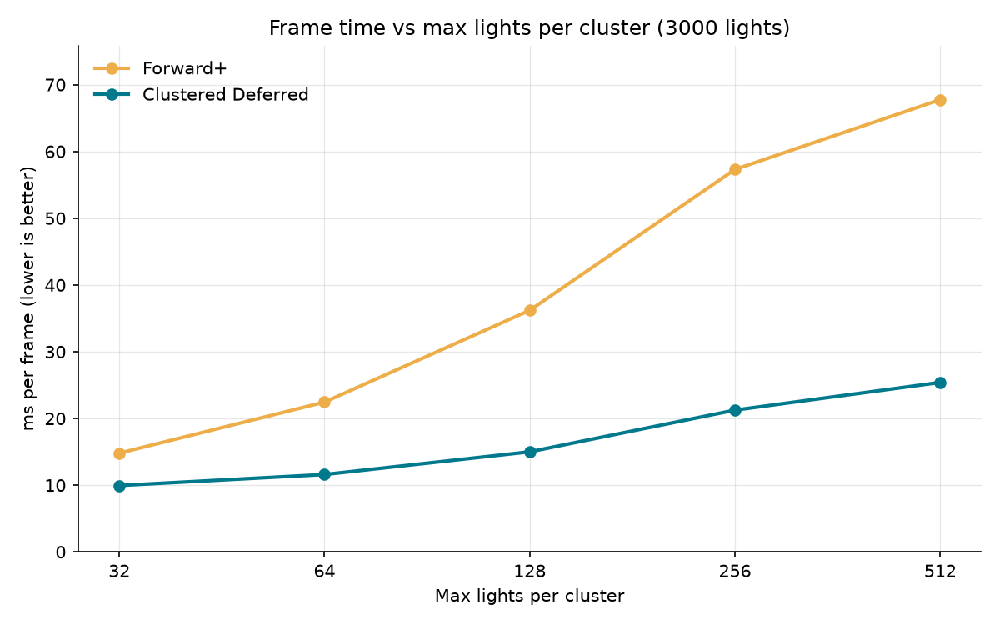
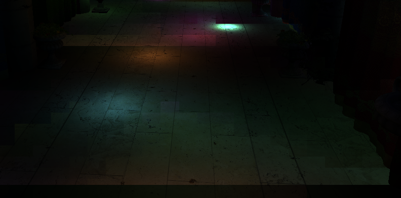
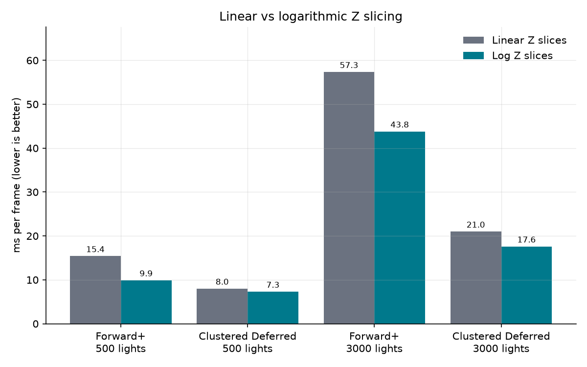
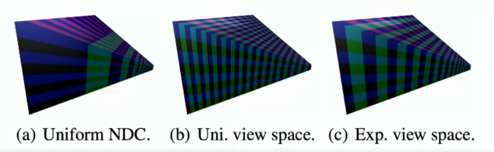

WebGPU Forward+ and Clustered Deferred Shading
======================

**University of Pennsylvania, CIS 565: GPU Programming and Architecture, Project 4**

* Mark Melkumyan
  * [LinkedIn](https://www.linkedin.com/in/mark-melkumyan/), [Portfolio](https://www.marklikes.art/)
* Tested on: Google Chrome, Windows 11, i7-10750H @ 2.60GHz, 64GB RAM, GTX 1650 Ti 4096MB

### Live Demo

> Click img above to try the demo live in your browser!

### Demo Video/GIF

[▶ Watch the 30s demo video (MP4)](img/demo30s.mp4)

## What is this?

A WebGPU renderer for the Sponza atrium lit by up to 5000 moving point lights, implemented three ways:

A renderer written in WebGPU optimized for high quantities of moving lights. We implement our rendering pipeline using 3 different strategies:

- **Naive**: The simplest approach. In our fragment shader, for each object, we look over each light to calculate it's contribution. This results in `O(N*M)` performance, where N=# of objects and M=# of lights. This scales quite very poorly when the scene contains thousands of lights!
  - *Passes:* Output color pass
- **Forward+**: Instead of EACH object looping over EACH light in the scene, we create a spatial datastructure of lights in a compute pass, allowing objects to only sample nearby lights. In the next pass we use this structure to only check lights nearby.
  - *Passes:* Light clustering pass -> Output color pass
- **Clustered Deferred**: First, make the light cluster data structure like before. But break down shading the pixels into two stages: geometry pass, which saves a texture of pixel positions, colors, and normals, then fullscreen output pass, where we combine the geometry textures to create the final image.
  - *Passes:* Light clustering pass -> Geoemtry pass -> Output color pass

## Features

- 3 rendering modes listed above: Naive, Forward+, and Clustered Deferred
- Togglable render settings in `shaders.ts` (including cluster counts and linear/log z slicing toggle)
- 3 debug modes shown below

### Debug modes

#### Cluster index

#### Light count

#### Full clusters

## Performance analysis

Methodology:

- Vsync disabled
- Measured using WebGPU timestamp queries
- 60 warmup frames are discarded, then 200 frames are captured
- Frane tune us CPU + GPU cost per frame

---
### Naive vs Forward+ vs Clustered Deferred

#### Notes:

- Naive performs quite poorly, scaling linearly with the number of lights.
- Forward and clustered perform *significantly* better. Except for very low light counts, clustered deferred performs better than forward+.

---
### Per-pass breakdown

#### Notes:

- Clustered achieves it's speed advantage over forward+ in the shading stage of the pipeline. In the forward+ shader, we perform full shading calculations for all fragments, even if they get overwritten by closer ones. In deferred, because we pass just the pixel buffers, we only ever shade the pixels displayed to screen. Thus, clustered deferred is much more performant. 

---
### Cluster grid size

#### Notes:

- Here we can see which cluster dimensions performed best. 32x18 in x/y, then 48 in the z performed best. This is likely because it best matched the screen aspect ratio and depth of the Sponza scene.

---
### Max lights per cluster

#### Notes:

- Less lights per cluster performs faster, but it's also more likely to suffer from visual artifacts. In my testing, 128 max lights per cluster seemed to strike a balance between performance with minimal artifacts.

> Visual artifacts when clusters hit max light count. You can see the boundaries of the clusters as they hit their limit.

---
### Linear vs logarithmic Z slicing

#### Notes:

- Log Z slicing performs better than linear Z slizes across the board. This is likely because it allocates less clusters farther away, and more clusters up close, which matches where most lights are in the Sponza scene.

> Visual diagram of how the different slicing approaches work. Note how c slices accounts for perspective divide, with farther slices being larger.

### Credits

- [Vite](https://vitejs.dev/)
- [loaders.gl](https://loaders.gl/)
- [dat.GUI](https://github.com/dataarts/dat.gui)
- [stats.js](https://github.com/mrdoob/stats.js)
- [wgpu-matrix](https://github.com/greggman/wgpu-matrix)
